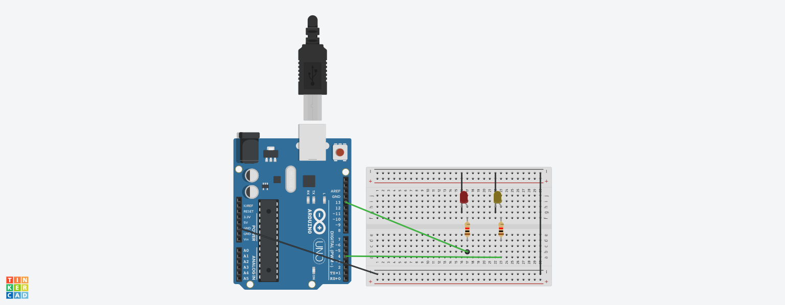

# SOS Blink (Tinkercad + Arduino)

Blinks an LED on pin 13 and 4 in the Morse code pattern for SOS (... --- ...), then pauses and repeats.

## What the professor provided
- The C++ code and the assignment steps

## What I did myself
- Built the circuit in Tinkercad: [e.g. LED + resistor connected to pin 13]
- Ran the simulation and checked that the pattern was correct

## What I learned
- How `pinMode`, `digitalWrite` and `delay` control an LED
- How functions (`shortBlink`, `longBlink`) avoid repeating code
- How simuations works

[View the project on Tinkercad](https://www.tinkercad.com/things/27LU4ONrngx-sos-signal)

